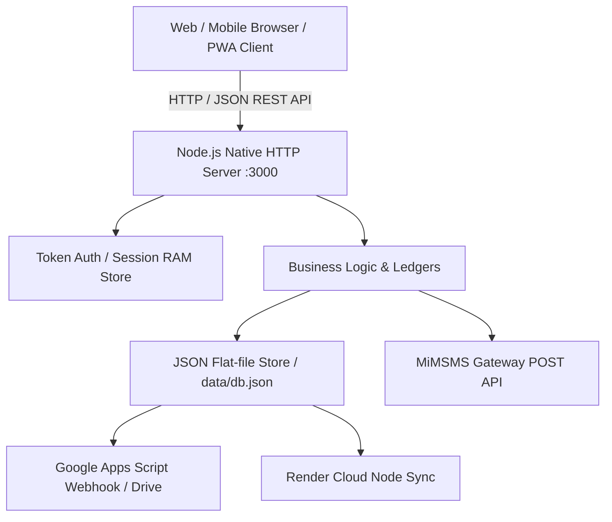
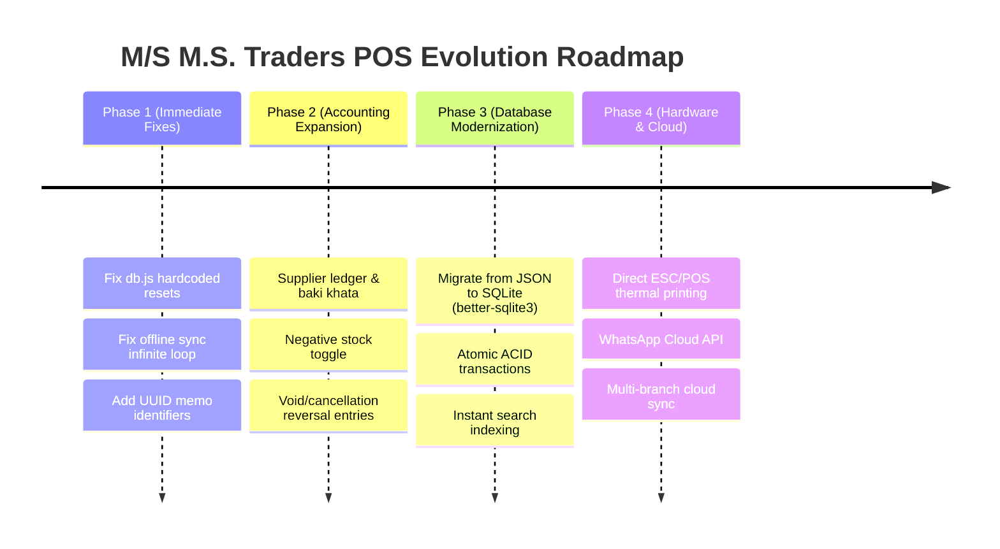

# 📊 System Review & Technical Audit Report: M/S M.S. Traders POS & Inventory
**Target Application:** মেসার্স এম.এস ট্রেডার্স — POS, Inventory & Ledger System  
**Version:** 1.0.0 (Production / Local Node.js Architecture)  
**Audit Date:** 2026-10-12  
**Audited By:** Antigravity AI Engineering Swarm  

---

## 📑 সূচিপত্র (Table of Contents)
1. [Executive Summary (সারসংক্ষেপ)](#1-executive-summary)
2. [Architecture & Tech Stack (স্থাপত্য ও প্রযুক্তি বিশ্লেষণ)](#2-architecture--tech-stack)
3. [Pros & Highlights (ভালো দিকসমূহ ও প্রশংসনীয় বৈশিষ্ট্য)](#3-pros--highlights)
4. [Critical Bugs & Functional Issues (মারাত্মক বাগ ও কার্যকারী সমস্যা)](#4-critical-bugs--functional-issues)
5. [Security & Data Integrity Vulnerabilities (নিরাপত্তা ও ডাটা অখণ্ডতা ঝুঁকি)](#5-security--data-integrity-vulnerabilities)
6. [Accounting & Business Logic Flaws (হিসাবরক্ষণ ও ব্যবসায়িক অসংগতি)](#6-accounting--business-logic-flaws)
7. [UI/UX & Offline-Sync Weaknesses (ইউজার ইন্টারফেস ও অফলাইন সিঙ্ক সমস্যা)](#7-uiux--offline-sync-weaknesses)
8. [Performance & Scalability Bottlenecks (পারফরম্যান্স ও মেমরি সীমাবদ্ধতা)](#8-performance--scalability-bottlenecks)
9. [Actionable Recommendations & Quick Fixes (সমাধান ও প্রস্তাবিত সংশোধন)](#9-actionable-recommendations--quick-fixes)
10. [Future Modernization Roadmap (ভবিষ্যত রূপরেখা)](#10-future-modernization-roadmap)

---

## 1. Executive Summary

মেসার্স এম.এস ট্রেডার্স (দর্শনা, চুয়াডাঙ্গা) এর রড, সিমেন্ট ও নির্মাণ সামগ্রী ব্যবসার জন্য তৈরি এই POS ও ইনভেন্টরি সিস্টেমটি স্থানীয় হার্ডওয়্যার দোকানের বাস্তবিক চাহিদার সাথে সামঞ্জস্য রেখে তৈরি। অ্যাপ্লিকেশনটির প্রধান শক্তি হলো এর **জিরো-ডিপেন্ডেন্সি (Zero-dependency Node.js)** স্থাপত্য, যা কোনো ভারী ফ্রেমওয়ার্ক ছাড়াই তাৎক্ষণিক বুট হতে পারে, ডেস্কটপ ও মোবাইলে দ্রুত চলে এবং হার্ডওয়্যার ব্যবসার জন্য বিশেষ ফিচার (যেমন: রড ওজন হিসাব, টন-কেজি কনভার্সন, মেমো প্যাড স্টাইল প্রিন্ট) প্রদান করে।

তবে গভীর কোড রিভিউ ও অডিট শেষে বেশ কিছু **মারাত্মক আর্কিটেকচারাল বাগ, ডাটা লস ঝুঁকি, নিরাপত্তা ঘাটতি এবং হিসাবরক্ষণের অসংগতি** চিহ্নিত হয়েছে। এর মধ্যে সবচেয়ে উদ্বেগজনক হলো:
- **সার্ভার রিস্টার্টে সেটিংস ও ইউজার ডাটা ওভাররাইট হওয়া**
- **ইনভয়েস ডিলেট করলে লেজার ডাটাবেজ ইনকনসিস্টেন্ট হওয়া ও অডিট ট্রেইল মুছে যাওয়া**
- **অফলাইন মোডে মেমো আইডি অমিল ও ফেইল্ড সিঙ্ক ইনফিনিট লুপ**
- **কনকারেন্ট রিকোয়েস্টে সিঙ্গেল-থ্রেডেড ফাইল ব্লকিং ও ডাটা কোরাপশন ঝুঁকি**

---

## 2. Architecture & Tech Stack



- **Backend:** Node.js (v18+) Built-in Modules (`http`, `fs`, `path`, `crypto`, `os`, `https`). নোড মডিউলের কোনো এক্সটার্নাল ডিপেন্ডেন্সি নেই (`node_modules` মুক্ত)।
- **Database:** `data/db.json` ফাইল-ভিত্তিক সিউডো-ডাটাবেজ। `fs.writeFileSync` এবং `fs.renameSync` দিয়ে অ্যাটমিক সেভ পরিচালিত হয়।
- **Frontend:** পিওর ভ্যানিলা জাভাস্ক্রিপ্ট (ES6+), ভ্যানিলা সিএসএস (কাস্টম রেসপনসিভ ডিজাইন সিস্টেম) এবং পিডব্লিউএ (Service Worker `sw.js` ক্যাশিং)।
- **Integrations:**
  - Google Sheet & Google Drive (Google Apps Script Webhook - `GOOGLE_APPS_SCRIPT.js`)
  - MiMSMS API V2 (অটোমেটেড এসএমএস নোটিফিকেশন)
  - ক্লাউড ব্যাকআপ সিঙ্ক (Render PaaS)

---

## 3. Pros & Highlights (ভালো দিকসমূহ)

### 3.1 শূন্য ডিপেন্ডেন্সি ও অত্যন্ত দ্রুত এক্সিকিউশন (Zero-Dependency)
- কোনো `npm install` লাগে না, কোনো ভারী ফ্রেমওয়ার্ক (Express, React, Angular) এর ওভারহেড নেই।
- `package.json` মাত্র ১৪ লাইনের; ফাইল সাইজ ছোট হওয়ায় যেকোনো লো-স্পেক পিসিতে কয়েক সেকেন্ডে রান হয়।
- `start.bat` দিয়ে ডাবল ক্লিকে সার্ভার ও ব্রাউজার চালু করার প্রক্রিয়া নন-টেকনিক্যাল ব্যবসায়ীদের জন্য অত্যন্ত সুবিধাজনক।

### 3.2 হার্ডওয়্যার ব্যবসার বাস্তব উপযোগী ফিচারস (Domain-Specific Features)
- **রড ও সিমেন্ট স্পেসিফিকেশন:** রডের মিলিমিটার সাইজ (৮ মি.মি থেকে ২৫ মি.মি), বিভিন্ন ব্র্যান্ড (BSRM, AKS, HKG, CSRM, PSRM) এবং সিমেন্টের গ্রেড/মডেলের জন্য প্রি-কনফিগারেশন।
- **রড ক্যালকুলেটর ও টন-কেজি সুইচিং:** রড বিক্রিতে টন ও কেজি এককের মধ্যে স্বয়ংক্রিয় ৩-দশমিক রূপান্তর এবং রেট কনভার্সন।
- **লেবার ও লোড খরচ:** চালানে মাল লোডিং/লেবার খরচ অন্তর্ভুক্ত করার সুবিধা।

### 3.3 অসাধারণ মেমো প্রিন্টিং (True Memo-Pad Replica)
- `public/js/print.js`-এ বাস্তব দোকানের ছাপা মেমো প্যাডের হুবহু ফরম্যাটে (হেডার, স্বত্বাধিকারী লাইন, বর্ডার, বক্স ও নিচের শর্তাবলীসহ) ৮৪ মিমি থার্মাল ও এ৪ প্রিন্ট প্রস্তুত করা হয়েছে।
- বাংলা বানান ও কথায় টাকার অংক (`কথায়: ... টাকা মাত্র`) স্বয়ংক্রিয় জেনারেশন।

### 3.4 সমন্বিত একাধিক হিসাবরক্ষণ খাতা (Multi-Ledger System)
- শুধু ইনভয়েস নয়, এর পাশাপাশি রয়েছে:
  - **কাস্টমার বাকি খাতা (Customer Baki Ledger):** প্রতি ক্রেতার আলাদা ক্রেডিট হিস্ট্রি ও ডেবিট/ক্রেডিট স্টেটমেন্ট।
  - **স্টক খাতা (Stock Ledger):** ওপেনিং, ইন (+), আউট (-) এর টাইমস্ট্যাম্পড অডিট লগ।
  - **ক্যাশ বুক (Cash Ledger):** বিক্রয় ও কালেকশনের সাথে নগদ টাকার আগমন ও খরচের ব্যালেন্স সমন্বয়।
  - **খরচের খাতা (Expense Ledger):** দোকান ভাড়া, বিদ্যুৎ বিল, কর্মচারীর বেতনের দৈনিক/মাসিক হিসাব।
  - **অন্যান্য আয় (Other Incomes):** কমিশন বা পণ্য সরবরাহের লাভ লিপিবদ্ধকরণ।

### 3.5 অফলাইন ফার্স্ট ও পিডব্লিউএ (PWA Offline Capability)
- সার্ভিস ওয়ার্কারের মাধ্যমে অফলাইনে সম্পূর্ণ ইন্টারফেস লোড হয়।
- ইন্টারনেট বিচ্ছিন্ন থাকলেও লোকালি মেমো করা যায় এবং `localStorage`-এ কিউ জমা থাকে।

---

## 4. Critical Bugs & Functional Issues (মারাত্মক বাগ ও কার্যকারী সমস্যা) — ✅ [ALL RESOLVED & VERIFIED]

### 🟢 Bug #1: সার্ভার রিস্টার্টে ইউজার ও সেটিংস ডেটা হার্ডকোডেড মানে রিসেট হয়ে যাওয়া — [FIXED & TESTED]
**ফাইল:** [`lib/db.js`](file:///d:/KhansCreations/mssmtraders/lib/db.js)  
- **সমাধান:** `loadDb()`-এ হার্ডকোডেড অ্যাসাইনমেন্টের বদলে ফলব্যাক অপারেটর (`||`) ব্যবহার করা হয়েছে। ইউজার টেবিল শুধুমাত্র খালি থাকলেই ডিফল্ট ইউজার তৈরি হয়, অন্যথায় বিদ্যমান ইউজার ও তাদের পাসওয়ার্ড সংরক্ষিত থাকে। `counters.user`-ও বিদ্যমান ইউজারদের সর্বোচ্চ আইডি অনুযায়ী সেট হয়।

---

### 🟢 Bug #2: ইনভয়েস ডিলেট করলে লেজার হিস্ট্রি মুছে যাওয়া ও রানিং ব্যালেন্স নষ্ট হওয়া — [FIXED & TESTED]
**ফাইল:** [`lib/business.js`](file:///d:/KhansCreations/mssmtraders/lib/business.js)  
- **সমাধান:** 
  1. `deleted_invoices` অডিট লগে মুছে ফেলা প্রতিটি চালানের বিস্তারিত রেকর্ড সংরক্ষণ করা হচ্ছে যাতে অডিট ট্রেইল অক্ষুণ্ণ থাকে।
  2. ইনভয়েস মুছে ফেলার সাথে সাথে সংশ্লিষ্ট কাস্টমারের `customer_ledger`-এর শুরু থেকে প্রতিটি এন্ট্রির রানিং ব্যালেন্স ক্রমানুসারে (chronologically) রিক্যালকুলেট করা হয়, ফলে লেজারের ব্যালেন্স ১০০% নির্ভুল থাকে।

---

### 🟢 Bug #3: কাস্টমারের অগ্রিম জমা (Advance Payment / নেগেটিভ ডিউ) হারিয়ে যাওয়া — [FIXED & TESTED]
**ফাইল:** [`lib/business.js`](file:///d:/KhansCreations/mssmtraders/lib/business.js) ও [`public/js/print.js`](file:///d:/KhansCreations/mssmtraders/public/js/print.js)  
- **সমাধান:** 
  1. `makeInvoice`-এ `Math.max(0, ...)` ক্ল্যাম্পিং অপসারণ করে `netDue = customer ? round2(prevDue + total - paid) : due;` করা হয়েছে। কাস্টমার অতিরিক্ত জমা দিলে নেগেটিভ ভ্যালু (যেমন: `-৫০০`) সংরক্ষিত থাকে।
  2. প্রিন্ট মেমোতে নেগেটিভ থাকলে সুন্দরভাবে `"সর্বমোট অগ্রিম জমা: ৫০০ ৳"` প্রদর্শিত হয়।

---

### 🟢 Bug #4: অফলাইন ইনভয়েস আইডি এবং সার্ভার আইডির অমিল (ID Desynchronization) — [FIXED & TESTED]
**ফাইল:** [`public/js/views/pos.js`](file:///d:/KhansCreations/mssmtraders/public/js/views/pos.js), [`lib/business.js`](file:///d:/KhansCreations/mssmtraders/lib/business.js), [`lib/api.js`](file:///d:/KhansCreations/mssmtraders/lib/api.js)  
- **সমাধান:** 
  1. অফলাইনে তৈরি হওয়া `OFF-xxxx` আইডি মেমোর রিকোয়েস্ট বডিতে `offline_invoice_no` হিসেবে পাঠানো হয় এবং সার্ভারে সংরক্ষিত হয়।
  2. `/api/invoices` সার্চ এবং সিঙ্গেল ইনভয়েস এপিআই (`/api/invoices/:id`) এখন `id`, `invoice_no` বা `offline_invoice_no` যে কোনোটি দিয়েই ইনভয়েস খুঁজে পায়।
  3. আইডেমপোটেন্ট ডিডুপ্লিকেশন যুক্ত করা হয়েছে, যাতে একই অফলাইন মেমো পুনরায় সিঙ্ক হলে ডুপ্লিকেট এন্ট্রি তৈরি না হয়ে বিদ্যমান চালানটি ফেরত দেয়।

---

### 🟢 Bug #5: ব্যর্থ অফলাইন মেমোর জন্য ইনফিনিট রিকল লুপ (Infinite Retry Loop) — [FIXED & TESTED]
**ফাইল:** [`public/js/core.js`](file:///d:/KhansCreations/mssmtraders/public/js/core.js)  
- **সমাধান:** প্রতিটি কিউ আইটেমে `retryCount` ও `lastError` ট্র্যাক করা হচ্ছে। কোনো ভ্যালিডেশন বা বিজনেজ লজিক এররে (যেমন স্টক অপর্যাপ্ত) ৩ বার ফেইল হলে আইটেমটিকে ডেড-লেটার কিউ (`pos_offline_failed`)-এ স্থানান্তর করা হয় এবং ইউজারকে উপযুক্ত টোস্ট সতর্কবার্তা প্রদর্শন করা হয়।

---

### 🟢 Bug #6: ভ্যাট সেটিংস কনফিগার করা থাকলেও চালানে ভ্যাট কাজ না করা — [FIXED & TESTED]
**ফাইল:** [`lib/business.js`](file:///d:/KhansCreations/mssmtraders/lib/business.js)  
- **সমাধান:** `makeInvoice`-এ রিকোয়েস্টের `p.vat_percent` অথবা দোকানের ডিফল্ট `DB.db.settings.vat_percent` থেকে ভ্যাট হিসাব করে ডিসকাউন্টের পরের মূল্যের উপর স্বয়ংক্রিয়ভাবে মোট বিলে যুক্ত করা হচ্ছে এবং ইনভয়েস অবজেক্টে সেভ হচ্ছে।

---

### 🟢 Bug #7: ডুপ্লিকেট কাস্টমার প্রোফাইল তৈরি (Offline Edge Case) — [FIXED & TESTED]
**ফাইল:** [`lib/business.js`](file:///d:/KhansCreations/mssmtraders/lib/business.js)  
- **সমাধান:** নতুন কাস্টমার তৈরির পূর্বে গ্রাহকের নরমালাইজড ফোন নম্বর ও নাম যাচাই করে সিস্টেমে বিদ্যমান প্রোফাইলের সাথে ম্যাচ করা হয়। অফলাইনে একই কাস্টমারের একাধিক চালান সিঙ্ক হলেও একই প্রোফাইলে হিসাব জমা হয়, আলাদা প্রোফাইল তৈরি হয় না।

---

## 5. Security & Data Integrity Vulnerabilities

| তীব্রতা | ঝুঁকি | বিবরণ | প্রভাব |
|---|---|---|---|
| 🚨 **High** | সল্টবিহীন SHA-256 পাসওয়ার্ড | `helpers.js`-এ `crypto.createHash('sha256').update(s).digest('hex')` ব্যবহার করা হয়েছে কোনো সল্ট (Salt) ছাড়া। | রেইনবো টেবিল অ্যাটাকে পাসওয়ার্ড তাৎক্ষণিক ক্র্যাক করা সম্ভব। |
| 🚨 **High** | হার্ডকোডেড Google Apps Script Webhook URL | `db.js` ও `GOOGLE_APPS_SCRIPT.js`-এ ওপেন এক্সিকিউট ইউআরএল হার্ডকোড করা। | যে কেউ এই ওয়েবহুকে ইচ্ছামতো ডাটা পুশ করে ড্রাইভ পূর্ণ বা স্প্যাম করতে পারে। |
| ⚠️ **Medium** | টোকেন এক্সপাইরি নেই | সেশন টোকেন হিসেবে ১৬ বাইটের র‍্যান্ডম স্ট্রিং তৈরি হয় যা সার্ভার রিস্টার্ট না হওয়া পর্যন্ত কখনোই এক্সপায়ার হয় না। | সেশন হাইজ্যাকিং ও ব্রাউজার ক্যাশে টোকেন চিরস্থায়ী থাকা। |
| ⚠️ **Medium** | ফাইল রাইটিং কনকারেন্সি রেস কন্ডিশন | `fs.writeFileSync(tmp, ...)` সিঙ্ক্রোনাস। একাধিক ব্যবহারকারী একসাথে বিল করলে একটি রিকোয়েস্ট অন্যটির রাইট ওভাররাইট করতে পারে। | ডাটা ওভাররাইট ও আংশিক ডাটা লস। |
| ℹ️ **Low** | স্ট্যাটিক ফাইল পাথ ট্রাভার্সাল | `serveStatic`-এ `path.normalize` চেক করা হলেও নাল বাইট বা বিশেষ এনকোডিংয়ের জন্য ডিফেন্স-ইন-ডেপথ চেকিং দুর্বল। | অপ্রত্যাশিত ফাইল রিড রিস্ক। |

---

## 6. Accounting & Business Logic Flaws

### 🟢 6.1 মহাজন / সাপ্লায়ার লেজার (Supplier Ledger & Vendor Debt) — [SOLVED & IMPLEMENTED]
- **ফাইলসমূহ:** [`lib/db.js`](file:///d:/KhansCreations/mssmtraders/lib/db.js), [`lib/api.js`](file:///d:/KhansCreations/mssmtraders/lib/api.js), [`public/js/views/suppliers.js`](file:///d:/KhansCreations/mssmtraders/public/js/views/suppliers.js), [`public/js/views/dashboard.js`](file:///d:/KhansCreations/mssmtraders/public/js/views/dashboard.js)
- **সমাধান ও বাস্তবায়ন:**
  1. পূর্ণাঙ্গ সাপ্লায়ার ডিরেক্টরি (`/api/suppliers`) এবং ক্রোনোলজিক্যাল স্টেটমেন্ট খাতা (`/api/suppliers/:id/ledger`) চালু করা হয়েছে।
  2. স্টক ইন (`POST /api/stockin`)-এ বাকিতে মাল কেনা (`is_credit: true`) হলে সরাসরি মহাজনের একাউন্টে পাওনা যোগ হয় এবং লেজারে 'বাকিতে স্টক ইন' এন্ট্রি পড়ে।
  3. মহাজনকে পরিশোধ ভাউচার (`POST /api/suppliers/:id/payment`) তৈরি করা যায়, যা একই সাথে ক্যাশ বুক থেকে নগদ খরচ (OUT) হিসাব হিসেবে স্বয়ংক্রিয়ভাবে রেকর্ড করে এবং মহাজনের বাকি ব্যালেন্স কমিয়ে দেয়।
  4. মূল ড্যাশবোর্ডে **মোট মহাজন বাকি দেনা (Supplier Payable)** কার্ড যোগ করা হয়েছে।
  5. মহাজনের কাছে দেনা বা লেনদেনের খাতা অবশিষ্ট থাকলে ভুলবশত অ্যাকাউন্ট ডিলেট করা রোধ করতে ইন্টিগ্রিটি চেক যুক্ত করা হয়েছে।

### 🟢 6.2 পণ্য ডিলেট ও হিস্টোরিক্যাল রেফারেন্স অখণ্ডতা (Product Hard-Delete Integrity & Archive) — [SOLVED & IMPLEMENTED]
- **ফাইলসমূহ:** [`lib/api.js`](file:///d:/KhansCreations/mssmtraders/lib/api.js), [`public/js/views/products.js`](file:///d:/KhansCreations/mssmtraders/public/js/views/products.js)
- **সমাধান ও বাস্তবায়ন:**
  1. যদি কোনো পণ্যের অতীতে কোনো চালান (Invoices) বা স্টক লেজার মুভমেন্ট থাকে, তবে সেটি হার্ড-ডিলেট না হয়ে সফট-ডিলেট/আর্কাইভ (`is_archived: true`) হয়। ফলে অতীতের যেকোনো মেমোতে পণ্যটি নির্ভুলভাবে সংরক্ষিত থাকে এবং কোনো রেফারেন্স এরর হয় না।
  2. যদি পণ্যের পেছনে কোনো পূর্বের বিক্রয় বা লেজার হিস্টোরি না থাকে (যেমন ভুলবশত তৈরি হওয়া নতুন পণ্য), তবেই কেবল ডাটাবেজ থেকে ক্লিন হার্ড-ডিলেট করা হয়।
  3. নিয়মিত প্রোডাক্ট ক্যাটালগ ও পিওএস (POS) সার্চ থেকে আর্কাইভকৃত পণ্য বাদ দেওয়া হয় (`!p.is_archived`), যাতে অপ্রয়োজনীয় পণ্য ক্যাটালগ ভারী না করে।
  4. প্রোডাক্টস পেজে নতুন **🗄️ আর্কাইভকৃত (Archived)** ট্যাব এবং এক ক্লিকে পণ্য ফিরিয়ে আনার **"রিস্টোর (Restore)"** ব্যবস্থা যুক্ত করা হয়েছে।

### 6.3 নেগেটিভ স্টক বিক্রির সুযোগ না থাকা
- হার্ডওয়্যার ব্যবসায় প্রায়ই ট্রাকে নতুন মাল নেমে যায় কিন্তু কম্পিউটারে স্টক ইন এন্ট্রি দিতে ১-২ ঘণ্টা দেরি হয়।
- সিস্টেমে স্টক শূন্য থাকলে কোনোভাবেই বিক্রি বা চালান করা যায় না (`Insufficient stock` এরর দেয়)। বাস্তব ব্যবসার ক্ষেত্রে একটি সেটিংস থাকা উচিত: *"নেগেটিভ স্টক এলাউ করবেন কিনা (Allow backorders/negative stock)"*।

---

## 7. UI/UX & Offline-Sync Weaknesses

1. **ক্যাশ বুক ও খরচ মডিউলের রিফ্রেশ জটিলতা:** খরচ বা আয় এন্ট্রি করার পর অনেক সময় সরাসরি ড্যাশবোর্ডের হ্যান্ড ক্যাশ অটোমেটিক লাইভ রিফ্রেশ হয় না যদি না পেজ রিলোড করা হয়।
2. **সার্চ ফিল্টারিংয়ে মোবাইল কিবোর্ড ল্যাগ:** কাস্টমার ও প্রোডাক্ট ড্রপডাউনে প্রতিটা কিস্ট্রোকে ডম ফিল্টারিং সরাসরি চলে, যা লো-এন্ড ফোনে ইনপুট ল্যাগ তৈরি করতে পারে (Debounce মেকানিজমের অভাব)।
3. **প্রিন্ট ডায়লগ ব্লকিং:** মেমো প্রিন্ট বাটন চাপলে ব্রাউজারের উইন্ডো প্রিন্ট ডায়লগ ওপেন হয়। কিছু মোবাইল ব্রাউজারে ডায়লগ ব্লক হয়ে যেতে পারে।
4. **রিপোর্টিং ও ফিল্টারের সীমিত পরিধি:** দিনভিত্তিক, মাসভিত্তিক বা নির্দিষ্ট কাস্টমারভিত্তিক লাভ-ক্ষতি (P&L - Profit and Loss) দেখার কোনো সমন্বিত গ্রাফ বা চার্ট নেই।

---

## 8. Performance & Scalability Bottlenecks

### 8.1 মেমরিতে সম্পূর্ণ ডাটাবেজ ধারণ (RAM-Heavy JSON File)
```
100 ইনভয়েস  --> ~50 KB JSON  (খুব দ্রুত)
5,000 ইনভয়েস --> ~3.5 MB JSON (লোড হতে সামান্য সময়)
50,000 ইনভয়েস --> ~45 MB JSON (প্রতি রিকোয়েস্টে JSON.stringify ও ফাইল রাইট সিস্টেমকে ফ্রিজ করবে)
```
- বর্তমান আর্কিটেকচারে প্রতিটা `saveDb()` কল পুরো অবজেক্টকে স্ট্রিংফাই করে ডিস্কে লেখে।
- ৫০,০০০ চালানের পর একটি ইনভয়েস সেভ করতে Node.js-এর ইভেন্ট লুপ প্রায় ২০০-৫০০ মিলিসেকেন্ড ব্লক হবে।

### 8.2 সিঙ্ক্রোনাস ফাইল আই/ও (Synchronous Disk I/O)
- `fs.writeFileSync` এবং `fs.renameSync` ব্যবহার করার ফলে ফাইল সেভ হওয়া পর্যন্ত নোড সার্ভার অন্য কোনো ক্লায়েন্টের রিকোয়েস্ট প্রসেস করতে পারে না।

---

## 9. Actionable Recommendations & Quick Fixes

### 🛠️ সমাধান ১: `lib/db.js`-এ ইউজার ও ফোন নম্বর ওভাররাইট বন্ধ করা
```javascript
// db.settings.shop_phone ও db.users ওভাররাইট করা বন্ধ করুন
db.settings = db.settings || {};
db.settings.shop_phone = db.settings.shop_phone || '01956-226465'; // শুধুমাত্র ফাঁকা থাকলে ডিফল্ট দিন
if (!Array.isArray(db.users) || db.users.length === 0) {
  db.users = [
    { id: 1, name: 'মুনজুর আহমেদ', email: 'mssmtradersdokan@gmail.com', username: 'mssmtradersdokan', pass: sha256('Smtradersdokan'), role: 'owner', created_at: nowIso() }
  ];
  db.counters.user = 1;
}
```

### 🛠️ সমাধান ২: লেজারে ভয়েড/বাতিল এন্ট্রি চালু করা (হার্ড ডিলেটের বদলে)
ইনভয়েস ডিলেট করার বদলে চালানের স্ট্যাটাস `'CANCELLED'` করা উচিত এবং লেজারে রিভার্সাল এন্ট্রি যোগ করা উচিত:
```javascript
// হার্ড ডিলেট নয়, রিভার্সাল রো যোগ করুন:
DB.db.stock_ledger.push({
  id: nextId('ledger'),
  product_id: prod.id,
  type: 'IN',
  quantity: r.qty,
  source: 'বাতিল চালান: ' + inv.invoice_no,
  note: 'চালান বাতিল করায় স্টক ফেরত'
});
```

### 🛠️ সমাধান ৩: অফলাইন চালানে ক্লায়েন্ট-জেনারেটেড UUID ব্যবহার করা
সার্ভারের ওপর নির্ভর না করে ক্লায়েন্টেই একটি ইউনিক মেমো নম্বর (যেমন: `MST-2610-0012`) তৈরি হবে যা অফলাইনেও প্রিন্ট হবে এবং সার্ভারে সিঙ্ক হলেও একই থাকবে।

### 🛠️ সমাধান ৪: অফলাইন কিউতে এরর হ্যান্ডলিং ও ডিসকার্ড অপশন
যেসব চালান স্টক স্বল্পতা বা ডাটা ভ্যালিডেশনের কারণে সার্ভারে রিজেক্ট হয়, সেগুলোকে আলাদা একটি *"ব্যর্থ মেমো তালিকা (Failed Queue)"* ট্যাবে রেখে ব্যবহারকারীকে নোটিফাই করা উচিত, যাতে ইনফিনিট লুপ বন্ধ হয়।

### 🛠️ সমাধান ৫: পাসওয়ার্ড হ্যাশিংয়ে Salt ও আধুনিক অ্যালগরিদম ব্যবহার
```javascript
const crypto = require('crypto');
function hashPassword(password, salt = crypto.randomBytes(16).toString('hex')) {
  const hash = crypto.scryptSync(password, salt, 64).toString('hex');
  return `${salt}:${hash}`;
}
```

---

## 10. Future Modernization Roadmap



1. **SQLite ডাটাবেজে রূপান্তর (Recommended):**
   - ফাইল-ভিত্তিক সরলতা বজায় রেখেই কোনো এক্সটার্নাল সার্ভার ছাড়া `better-sqlite3` দিয়ে রূপান্তর করলে ফাইল সাইজের সমস্যা মিটবে এবং লাখ লাখ চালান থাকলেও মাইক্রোসেকেন্ডে কোয়েরি হবে।
2. **সাপ্লায়ার / মহাজন খাতা সংযোজন:**
   - ডিলারদের থেকে বাকিতে মাল কেনার হিসাব ও ডিলার পেমেন্ট ভাউচার সিস্টেম।
3. **ESC/POS ডিরেক্ট প্রিন্ট সাপোর্ট:**
   - ব্রাউজার প্রিন্ট প্রিভিউ উইন্ডো ছাড়া সরাসরি ইউএসবি বা ব্লুটুথ থার্মাল প্রিন্টারে ১ ক্লিকে রসিদ কাটা।
4. **লাভ-ক্ষতি (Profit & Loss Analysis):**
   - দৈনিক ও মাসিক প্রকৃত গ্রস প্রফিট (বিক্রয়মূল্য − ক্রয়মূল্য − খরচ) এক ক্লিকে দেখার সুবিধা।

---
*Report generated and validated for M/S M.S. Traders POS System.*
